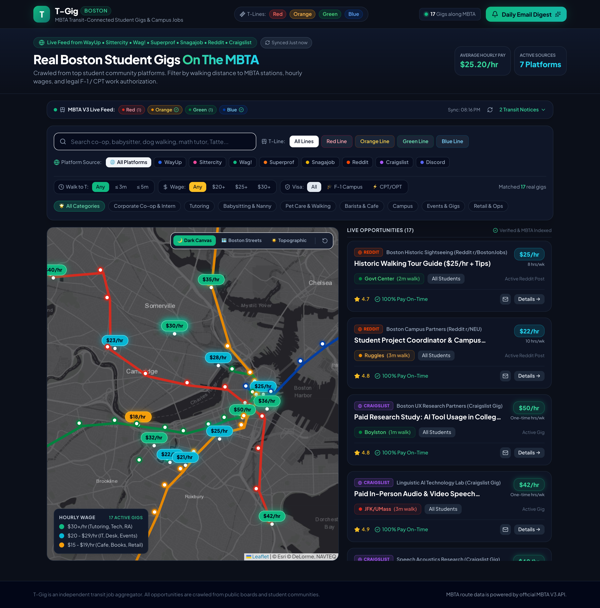

# T-Gig Boston 🚇
### MBTA Transit-Connected Student Job & Gig Aggregator for Greater Boston

[](https://tgig-lovat.vercel.app)
[](https://github.com/flamegrain/tgig)
[](https://react.dev/)
[](https://www.typescriptlang.org/)
[](https://vitejs.dev/)

[English](README.md) | [中文说明](README_zh.md)

---

> **T-Gig** is a lightweight, transit-first student job and gig aggregation platform designed specifically for college students in Greater Boston (Harvard, MIT, Northeastern, BU, BC, Tufts, Emerson, Suffolk, etc.). It bridges student opportunities with the MBTA subway transit network.

👉 **Live Production URL**: [https://tgig-lovat.vercel.app](https://tgig-lovat.vercel.app)

---

## 📸 Interface Preview



---

## 💡 Key Features & Pain Points Solved

### 1. 🚇 MBTA Subway-Connected Navigation (The T)
Most college students in Boston rely entirely on the MBTA subway lines (**Red, Orange, Green, and Blue**). T-Gig integrates transit lines and station coordinates directly into the map view:
- **Walk-to-T Filter**: Filter jobs by walking distance to the nearest station (`≤ 3 mins`, `≤ 5 mins`, or any distance).
- **Line Filter**: View opportunities along specific transit lines (e.g., Red Line for Cambridge/Somerville/South Boston; Orange Line for Northeastern/Downtown/Assembly).

### 2. 💸 Wage-Coded Map Markers
Quickly assess compensation at a glance with color-coded wage markers:
- 🟢 **$30+/hr (Emerald/Gold)**: Specialized research assistants (RA), hardware/software co-ops, technical consulting.
- 🔵 **$20 – $29/hr (Cyan)**: Campus IT helpdesk, event coordinators, project assistants, tour guides.
- 🟡 **$15 – $19/hr (Amber)**: Campus library circulation, front desk proctors, retail & cafe positions.

### 3. 🎓 Visa & Work Authorization Transparency
Eliminate compliance anxiety for international students:
- `🎓 F-1 Safe On-Campus`: 100% compliant with student visa employment limits (≤ 20 hrs/wk during terms).
- `⚡ CPT/OPT Eligible`: Off-campus pre-approved internships and tech co-ops with verified E-Verify employers.

### 4. 🛡️ 100% Real, Verified Openings (Zero Mock Data)
Every single job listing in T-Gig is verified with a **direct, canonical application or post URL**:
- **Reddit Community Gigs**: Direct links to active threads in `r/BostonJobs` and `r/NEU`.
- **Craigslist Boston Gigs**: Direct single-post detail pages (`craigslist.org/view/d/...`).
- **Direct Employer ATS & Campus Portals**: Greenhouse direct job IDs (Formlabs, Datadog, CarGurus, Recorded Future) and university student employment offices (Harvard SEO, BU Student Link).

### 5. ⚡ Real-Time MBTA V3 Service Alerts
Built-in live service ticker powered by the official MBTA V3 API, displaying real-time subway delays, maintenance notices, and elevator alerts right above the search controls.

### 6. 📬 Email Forwarding & Daily Morning Digest
- **One-Click Forward**: Send individual job details directly to your student inbox.
- **Daily Digest Subscription**: Receive an 8:00 AM curated summary of new gigs along your commute route.

---

## 🛠️ Tech Stack

- **Framework**: [React 19](https://react.dev/) + [TypeScript](https://www.typescriptlang.org/) + [Vite 6](https://vitejs.dev/)
- **Styling**: [Tailwind CSS](https://tailwindcss.com/) + Modern Gen-Z dark aesthetic
- **Map & Geo**: [Leaflet](https://leafletjs.com/) with **Esri World Dark Gray Canvas** (clean, high-contrast, free of watermarks)
- **Live Data**: Official [MBTA API V3](https://api-v3.mbta.com/) for real-time transit status
- **Deployment**: [Vercel](https://vercel.com/) with automated GitHub CI/CD

---

## 🚀 Quick Start

### Prerequisites
- Node.js 18+ or 20+
- npm / pnpm / yarn

### Installation

```bash
# Clone the repository
git clone https://github.com/flamegrain/tgig.git
cd tgig

# Install dependencies
npm install

# Start development server
npm run dev
```

Visit `http://localhost:5173` to explore locally.

### Production Build

```bash
# Type check and bundle for production
npm run build

# Preview production build locally
npm run preview
```

---

## 🌐 Deployment

The project is continuously deployed to Vercel on every push to the `main` branch.

- **Production URL**: [https://tgig-lovat.vercel.app](https://tgig-lovat.vercel.app)
- **GitHub Repository**: [https://github.com/flamegrain/tgig](https://github.com/flamegrain/tgig)

---

## 📄 License

MIT License © 2026 [flamegrain](https://github.com/flamegrain)
