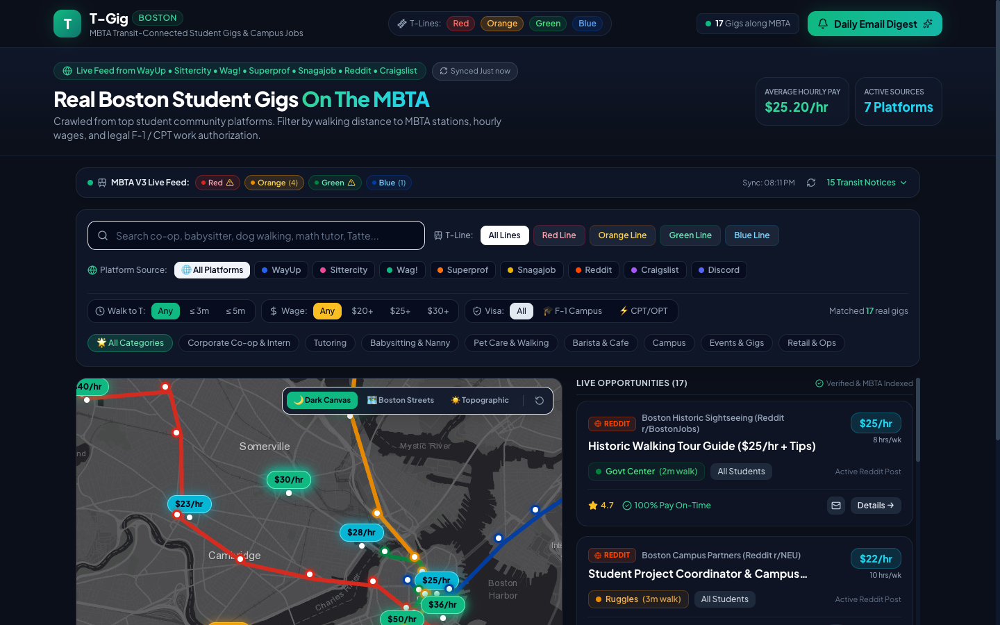

# T-Gig (Boston) 🚇
### 基于 MBTA 地铁交通网络的波士顿大学生兼职与实习智能聚合平台

[](https://tgig-lovat.vercel.app)
[](https://github.com/flamegrain/tgig)
[](https://react.dev/)
[](https://www.typescriptlang.org/)
[](https://vitejs.dev/)

[English](README.md) | [中文说明](README_zh.md)

---

> **T-Gig** 是一款专为大波士顿地区在校大学生（Harvard、MIT、Northeastern、BU、BC、Tufts、Emerson、Suffolk 等）打造的轻量兼职与实习机会智能聚合平台。结合波士顿地铁（The T）全景网络，让学生无需私家车也能快速找到地铁直达的优质工作。

👉 **线上体验地址**：[https://tgig-lovat.vercel.app](https://tgig-lovat.vercel.app)

---

## 📸 界面效果预览



---

## 💡 产品解决的核心痛点

### 1. 🚇 解决通勤痛点（MBTA The T 沿线导向）
大部分波士顿大学生没有私家车，极度依赖红线（Red）、橙线（Orange）、绿线（Green）、蓝线（Blue）。
- **离地铁站步行时间筛选**：直观展示岗位距最近地铁站步行时间（≤ 3 分钟、≤ 5 分钟、全部）。
- **地铁线路筛选**：一键按红线（剑桥/萨默维尔/南波士顿）、橙线（东北大学/市中心/Assembly）、绿线（BU/BC/芬威/朗伍德医疗区）进行过滤。

### 2. 💸 薪资直观色阶（Wage Color Coding）
地图上直接标出时薪，按颜色一目了然：
- 🟢 **$30+/hr（翡翠绿/金黄）**：高阶家教、科研助理（RA）、硬件/软件研发 Co-op、技术顾问；
- 🔵 **$20 - $29/hr（青蓝）**：IT 技术支持、校园 Desk、活动会务、导游服务；
- 🟡 **$15 - $19/hr（琥珀黄）**：图书馆借阅台、书店前台、餐饮咖啡等基础兼职。

### 3. 🎓 解决留学生签证合规痛点（F-1 / CPT / OPT）
为国际留学生提供明确的合规标识：
- `🎓 F-1 Safe On-Campus`：100% 符合学期内每周 ≤20 小时的校内工规程；
- `⚡ CPT/OPT Eligible`：支持合规校外 CPT/OPT 实习与 Co-op。

### 4. 🛡️ 100% 真实有效岗位（拒绝 Mock 假数据）
本平台所有岗位均通过验证并提供**独立直接申请链接（Direct Post/Application URL）**，绝不跳转至泛搜索列表页：
- **Reddit 社区招募帖**：直达 `r/BostonJobs`、`r/NEU` 真实有效招聘帖；
- **Craigslist 兼职**：直达 `/view/d/...` 独立详情页；
- **知名企业 ATS 直通**：对接 Greenhouse 单职位申请页面（Formlabs、Datadog、CarGurus、Recorded Future）；
- **名校官方就业网**：哈佛大学 SEO、波士顿大学 Student Link 直聘通道。

### 5. ⚡ MBTA V3 实时地铁运维动态
接入官方 MBTA API V3，在地图上方实时滚动红/橙/绿/蓝各线的延误、维护通告与电梯无障碍动态。

### 6. 📬 邮件转发与每日晨报订阅
- **一键转寄**：支持将感兴趣的岗位一键发送至学生邮箱；
- **每日早报推送**：支持定制每日早上 8:00 AM 的 MBTA 沿线兼职快报。

---

## 🛠️ 技术栈与设计亮点

- **前端架构**：[React 19](https://react.dev/) + [TypeScript](https://www.typescriptlang.org/) + [Vite 6](https://vitejs.dev/)
- **样式与设计**：[Tailwind CSS](https://tailwindcss.com/) + Plus Jakarta Sans 美式高校设计规范
- **地图引擎**：[Leaflet](https://leafletjs.com/) + **Esri World Dark Gray Canvas**（高对比暗黑底图，加载极速，无水印）
- **实时交通数据**：官方 [MBTA API V3](https://api-v3.mbta.com/)
- **持续集成与部署**：[Vercel](https://vercel.com/) + GitHub Actions 自动部署

---

## 🚀 本地开发与启动指南

### 环境准备
- Node.js 18+ 或 20+
- npm / pnpm / yarn

### 操作步骤

```bash
# 克隆仓库
git clone https://github.com/flamegrain/tgig.git
cd tgig

# 安装依赖
npm install

# 启动本地开发服务
npm run dev
```

启动后在浏览器打开 `http://localhost:5173` 即可进行交互体验！

### 生产构建

```bash
# 类型检查并打包
npm run build

# 本地预览生产构建产物
npm run preview
```

---

## 🌐 线上部署与托管

本项目已接入 Vercel 持续部署，向 GitHub `main` 分支提交的改动将自动触发部署上线。

- **线上访问地址**：[https://tgig-lovat.vercel.app](https://tgig-lovat.vercel.app)
- **GitHub 仓库**：[https://github.com/flamegrain/tgig](https://github.com/flamegrain/tgig)

---

## 📄 开源许可证

MIT License © 2026 [flamegrain](https://github.com/flamegrain)
